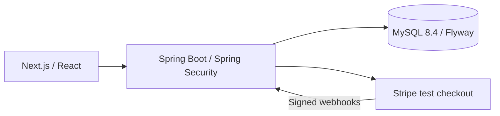

# Rocky.Tech — E-Commerce Platform

A full-stack shopping application connecting product discovery, a persistent cart, vouchers, stock reservation and verified payment order history.

**[Live application](https://shop.imrocky.com)** · **[Author's portfolio](https://imrocky.com)**

## Features

- Browse products and categories through a responsive Next.js storefront.
- Maintain a browser cart and complete checkout through Stripe test mode.
- Recalculate prices on the server and reserve stock and voucher usage during checkout.
- Verify Stripe webhook signatures and handle repeated payment events.
- Register, sign in, view orders, change passwords and revoke sessions.
- Manage products, categories, stock and orders through administrator pages.

## Architecture



Java 17, Spring Boot 3, JPA and Flyway provide the backend. Prices use `BigDecimal` and integer HKD cents for payment totals. MySQL is used in development and production. Uploaded catalog files are runtime data, separate from source-controlled frontend images.

## Run locally

Requires Java 17, Node.js 24, npm and a dedicated MySQL 8.4 database. Create a database and application user for this project only.

1. Copy the root `.env.example` to `.env` and fill in your own local database credentials, Stripe **test** API key and webhook signing secret. Load the variables into your shell, or configure the equivalent variables in your IDE. Spring Boot does not load shell `.env` files automatically.
2. Install frontend dependencies and run the backend and frontend in separate terminals:

```sh
# Terminal 1, repository root; load your completed local environment first.
set -a
. ./.env
set +a
cd backend
./mvnw spring-boot:run
```

```sh
# Terminal 2, repository root.
npm ci --prefix frontend
cd frontend
NEXT_PUBLIC_API_URL=/api BACKEND_URL=http://127.0.0.1:8080 npm run dev
```

The frontend defaults to `http://localhost:3000`; the backend uses port 8080. Flyway applies schema migrations automatically. Start with a new local database rather than importing a production database or the former SQLite database.

To initialize your own administrator, set `SHOP_BOOTSTRAP_ENABLED=true`, `SHOP_ADMIN_EMAIL` and a strong `SHOP_ADMIN_PASSWORD` for one initial start, then disable bootstrap. Existing accounts are not promoted or reset. Optional sample product inserts are in `backend/demo/seed.sql`; review them before using them in a disposable local database. A new catalog can also be created through the administrator interface.

## Verification

```sh
cd backend
./mvnw clean verify
cd ../frontend
npm run typecheck
npm run build -- --webpack
```

Backend integration tests use a disposable MySQL Testcontainer and a mock payment gateway; Docker must be available. These commands describe the available checks, not a claim that all integration tests were rerun for this source publication.

## Limits

This is a single-instance portfolio application. Sessions are held in process, so a backend restart requires signing in again. Catalog and order lists are not paginated. Stripe Session creation occurs within the checkout transaction; payment reconciliation and a periodic reservation-release worker remain future work. The live demonstration uses Stripe test mode.

## Repository contents

Application source, dependency lockfiles, schema migrations, tests, safe configuration templates and frontend assets are included. Local credentials, private keys, databases, reports, user uploads, generated builds and old Git history are excluded. Production hosting and shared infrastructure are managed separately from this repository.

## One-click portfolio demo (2026-11-02)

The guest demo update is being released. The application entry is `/demo`; no shared credentials are required. Normal login remains available. See [demo setup, limits, tests and rollout](docs/ONE-CLICK-DEMO.md).

Public registration is available through `/register` and has a visible Register button.
